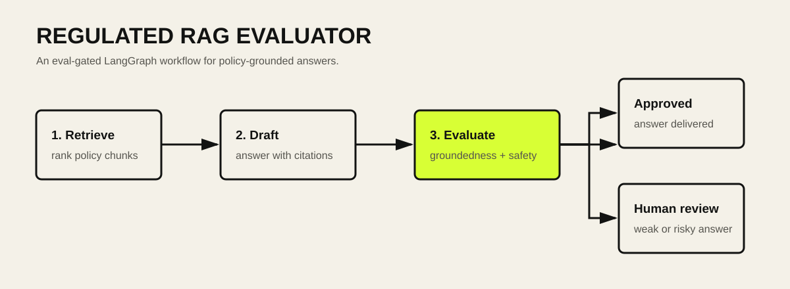
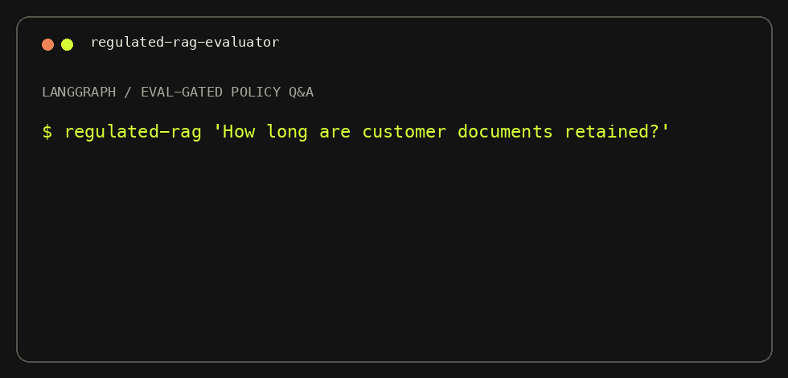

# Regulated RAG Evaluator

An eval-gated **LangGraph** workflow for answering policy questions in regulated settings. It retrieves policy evidence, drafts a cited answer, evaluates grounding and safety, then either approves the answer or routes it to human review.





## Why this exists

RAG demos often stop at retrieval and generation. In regulated work, that is not sufficient: an answer needs traceable evidence, citation coverage, and an explicit escalation path when it is not trustworthy enough to deliver.

## Workflow

1. **Retrieve** — rank relevant policy chunks.
2. **Draft** — produce a cited answer from retrieved evidence.
3. **Evaluate** — check citation coverage, groundedness, and security-escalation language.
4. **Route** — approve strong answers or send weak/risky answers to a reviewer.

## Quick start

```bash
git clone https://github.com/paartheee/regulated-rag-evaluator.git
cd regulated-rag-evaluator
python -m venv .venv
source .venv/bin/activate
pip install -e .
regulated-rag "How long are customer documents retained after a case is closed?"
```

Run the test suite:

```bash
pip install pytest
pytest
```

## Sample output

```json
{
  "route": "approved",
  "citations": ["POL-RET-01", "POL-SEC-02"],
  "evaluation": {
    "groundedness": 1.0,
    "citation_coverage": 1.0,
    "approved": true
  }
}
```

## Production extension points

- Replace `draft_answer` with a model provider such as ChatOpenAI or an internal approved model.
- Replace token-overlap retrieval with a vector store and document-level access controls.
- Persist traces and evaluator results to LangSmith.
- Add policy versioning, audit logs, redaction, and human-review queues.

## Stack

- Python
- LangGraph
- Deterministic demo corpus (no API key required)
- Pytest

## Author

Built by [Parthiban Marimuthu](https://www.parthi.xyz), AI/ML Engineer focused on production RAG and agentic AI systems.
